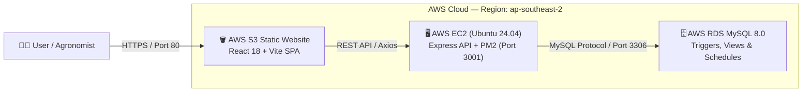

# 🌱 Seed Bank Management System (Agricultural Genetic Vault)

[](https://aws.amazon.com/)
[](https://nodejs.org/)
[](https://react.dev/)
[](https://aws.amazon.com/rds/mysql/)
[](https://tailwindcss.com/)

An enterprise-grade agricultural management platform designed to conserve indigenous crop varieties, track physical seed lots, monitor cold storage climates, and manage distributions to local farming cooperatives.

---

## 🌐 Live Deployment & Demo Credentials

| Component | Endpoint | Status |
| :--- | :--- | :--- |
| **Web Application** | [Live Web App](http://seedbank-frontend-804988747267-ap-southeast-2.s3-website.ap-southeast-2.amazonaws.com) | `Active (S3)` |
| **REST API Base** | `http://ec2-3-104-76-247.ap-southeast-2.compute.amazonaws.com:3001/api` | `Active (EC2)` |
| **Database** | `seedbank-db.cfkum0csqlb4.ap-southeast-2.rds.amazonaws.com:3306` | `Active (RDS MySQL 8.0)` |

### 🔑 Default Administrator Login
- **Email**: `admin@example.com`
- **Password**: `Password123`
> **Tip**: The login page includes a **"One-Click Demo Login"** button for immediate access without manual typing.

---

## 🏗️ Architecture Overview



---

## ✨ Key Capabilities

1. **Accession & Seed Varieties Catalog**:
   - Manage crop varieties across cereals, millets, pulses, vegetables, and oilseeds.
   - Record genetic traits (e.g. drought resistance, nutritional profile), origin regions, optimal germination temperatures, and target moisture levels.
2. **Physical Batch Tracking & Inventory**:
   - Track physical seed batches under active cold refrigeration.
   - Automated remaining stock calculation (`quantity_kg` minus distributions).
   - Dynamic expiration forecasting via MySQL triggers based on accession viability days.
3. **Viability & Germination Assays**:
   - Record laboratory germination test percentages and moisture content assays.
   - Automated status classification: **Pass** (>80%), **Borderline** (65–80%), and **Fail** (<65% / quarantine).
4. **Seed Distribution Management**:
   - Log seed allotments to farmers, universities, and conservation organizations.
   - Enforces database-level stock checks to prevent negative inventory allocations.
5. **Storage Facilities & Climate Control**:
   - Monitor facility temperatures, relative humidity, and real-time volumetric capacity utilization bars (<70% Green, 70–90% Amber, >90% Red).
6. **Executive Dashboard & Urgency Alerts**:
   - 6 high-level KPI cards with automatic urgency alert styling for batches expiring in 30 days and storage anomalies.

---

## 🎨 UI Design System & How to Use Stitch

The UI follows the modern botanical agricultural design specification documented in [`ui-reference.md`](file:///home/jois/Downloads/seed-bank-main/ui-reference.md).

### Design Tokens
- **Forest Green (Primary)**: `#2D6A4F` (Buttons, accents)
- **Deep Botanical (Sidebar / Brand)**: `#1B4332` (Sidebar background)
- **Soft Mint (Pale Accent)**: `#D8F3DC` (Selected navigation item background)
- **Neutral Canvas**: `#F8F9FA` (Page surface)
- **Cards**: `#FFFFFF` with `#E9ECEF` border and rounded corners (`12px`)

### Using Stitch or AI Design-to-Code Tools
If you want to use **Google Stitch** (or generative UI design tools like Stitch, Figma AI, or v0) to generate additional screens or components:

1. **Provide the System Context & Color Palette**:
   Prompt Stitch with the exact color variables and styling constraints:
   ```text
   Design an agricultural seed bank management screen in React + Tailwind CSS.
   Colors:
   - Primary dark green: #2D6A4F
   - Sidebar forest green: #1B4332
   - Light mint active state: #D8F3DC
   - Surface background: #F8F9FA
   Typography: Inter, sans-serif
   Icons: lucide-react
   Card styling: rounded-xl, 1px border #E9ECEF, subtle drop shadow.
   ```
2. **Define Screen Specifications**:
   - For tables: Request sticky headers, uppercase 11px column headers in gray, alternating row hover, and action buttons.
   - For status badges: Request pill badges (`px-2.5 py-0.5 rounded-full text-xs font-semibold`) using `#D8F3DC` for active/pass, `#FFE5E5` for expired/fail, and `#FFF3CD` for quarantine/borderline.
3. **Export and Integrate into the Codebase**:
   - Save new components into `frontend/src/components/ui/` or `frontend/src/pages/`.
   - Use the pre-configured `api` Axios instance (`frontend/src/api/axiosInstance.js`) to automatically inject JWT authentication headers.
   - Register routes inside [`frontend/src/App.jsx`](file:///home/jois/Downloads/seed-bank-main/frontend/src/App.jsx) wrapped under `<ProtectedRoute>`.

---

## 🚀 Local Development Setup

### 1. Prerequisites
- Node.js 20+ LTS
- MySQL 8.0+

### 2. Backend Setup
```bash
cd backend
cp .env.example .env
# Configure your local DB_HOST, DB_USER, DB_PASS, and DB_NAME in .env

npm install
# Import database schema:
mysql -u root -p seed_bank < db/schema.sql

# Start backend development server (port 3001)
npm run dev
```

### 3. Frontend Setup
```bash
cd frontend
npm install

# Start Vite dev server (port 5173)
npm run dev
```

---

## ☁️ AWS Cloud Deployment (Free-Tier Eligible)

The repository includes turnkey automation scripts for AWS:

### 1. Provision Infrastructure
Provisions Default VPC discovery, Security Groups, S3 Bucket, Ubuntu 24.04 EC2 instance, and RDS MySQL 8.0 (`db.t3.micro`):
```bash
./deploy/deploy.sh
```

### 2. Configure EC2 Backend & Import Schema
Transfers backend code to EC2, sets up Node 20 + PM2, imports [`backend/db/schema.sql`](file:///home/jois/Downloads/seed-bank-main/backend/db/schema.sql) into RDS, and seeds the initial admin account:
```bash
./deploy/ec2-setup.sh
```

### 3. Build & Deploy Frontend to S3
Builds the React application targeting the EC2 API endpoint and synchronizes assets to S3 static website hosting:
```bash
./deploy/frontend-deploy.sh
```

### 4. Teardown All AWS Resources
When you are done testing, tear down all provisioned cloud resources to prevent ongoing charges:
```bash
./deploy/teardown.sh
```

---

## 📂 Project Structure

```
├── backend/
│   ├── controllers/      # Express controllers (auth, batches, varieties, etc.)
│   ├── db/
│   │   ├── connection.js # mysql2/promise pool connection
│   │   └── schema.sql    # DDL: tables, triggers, views, and seed data
│   ├── middleware/       # JWT auth & error handlers
│   ├── routes/           # Express route definitions
│   └── server.js         # API entrypoint (port 3001)
├── frontend/
│   ├── src/
│   │   ├── api/          # Axios instance and API services
│   │   ├── components/   # Layout (Sidebar, TopBar), Auth guards, and UI components
│   │   ├── context/      # AuthContext (JWT management & profile state)
│   │   ├── pages/        # Dashboard, Login, Varieties, Batches, Distributions, etc.
│   │   └── index.css     # Tailwind v4 theme & botanical design system
│   └── vite.config.js    # Vite configuration
├── deploy/
│   ├── deploy.sh         # AWS Free-Tier infrastructure provisioning
│   ├── ec2-setup.sh      # EC2 backend & RDS schema deployment
│   ├── frontend-deploy.sh# Vite build & S3 sync
│   └── teardown.sh       # Cloud resource cleanup
├── ui-reference.md       # Visual design system specifications
└── README.md             # Project documentation
```
